<!-- a oficina do gabriel: três máquinas que montam o perfil ao vivo, em loop (SVG + SMIL, sem JavaScript).
     plotter:    python scripts/prep_avatar.py && python scripts/make_plotter_svg.py   (foto de perfil do GitHub e texto)
     recibo:     python scripts/render_receipt_svg.py (projetos; edite PROJECTS)
     impressora: python scripts/render_printer_svg.py (commits; atualizado todo dia pela Action) -->

[**App Remédios**](https://github.com/GSerejo/App-remedios) · [vídeo](https://www.youtube.com/watch?v=M813-sd0z9c) &nbsp;|&nbsp;
[**clone-tabnews**](https://github.com/GSerejo/clone-tabnews) · [site](https://gserejo.com.br) &nbsp;|&nbsp;
[**Curriculo**](https://github.com/GSerejo/Curriculo) · [site](https://gserejo.github.io/Curriculo/) &nbsp;|&nbsp;
[**365prints**](https://github.com/GSerejo/365prints) · [site](https://365prints.vercel.app)

 

 
 

